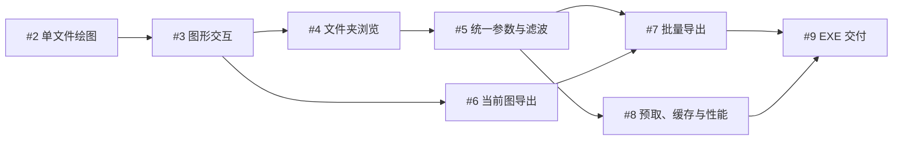

# RAW 时频图应用任务拆分与发布记录

来源：[规格 #1](https://github.com/JimYang816/TF_Decoder/issues/1)。状态：用户已确认 8 项拆分，全部发布并回读核对，均标记 ready-for-agent。

## 实现状态（2026-11-06）

- #2–#8：已实现、合入 `codex/raw-spectrogram-app`，测试证据已评论，各任务已关闭。
- #9：实现与离线 Windows ZIP 已交付，固定基准审查修复后 47 项测试通过；任务保留打开，待完整打包原生流程及干净 Windows 验收。用户确认无干净环境，要求明确列为待验收。
- [交付包与校验](../../portable-delivery.md)、[固定基准审查](../../reviews/fixed-baseline-review.md)、[数值核对](../../numerical-parity.md)、[性能记录](../../performance/browser-2026-11-06.md)。

当前仓库没有应用代码，无需前置重构。每项任务交付一个可操作、可验证的完整使用场景；界面、应用编排和行为测试随功能一起完成，主要复用规格中已确认的同一个应用级测试入口。

## 已发布的任务

| 本地编号 | GitHub 任务 | 直接阻塞 issue | 完成后的行为 |
| --- | --- | --- | --- |
| 01 | [#2 打开单个采集文件并显示原程序一致的时频图](https://github.com/JimYang816/TF_Decoder/issues/2) | 无 | 中文桌面窗口选择一个 RAW，显示正确的坐标、PSD 与色条，以及成功、警告或失败状态 |
| 02 | [#3 交互缩放与平移当前时频图](https://github.com/JimYang816/TF_Decoder/issues/3) | #2 | 当前图支持滚轮缩放、平移、框选放大、恢复全图，强度色阶保持稳定 |
| 03 | [#4 递归导入文件夹并逐张浏览采集文件](https://github.com/JimYang816/TF_Decoder/issues/4) | #3 | 多级文件夹生成自然排序列表，前后／点选切图并恢复各文件视口，异常文件不阻断浏览 |
| 04 | [#5 统一应用采样、时频与频段滤波参数](https://github.com/JimYang816/TF_Decoder/issues/5) | #4 | 当前批次统一设置采样率、STFT、真实滤波及独立显示频段，点击应用后显示新结果 |
| 05 | [#6 导出当前文件的局部或全时段 PNG](https://github.com/JimYang816/TF_Decoder/issues/6) | #3 | 在界面选择导出目录，保存当前缩放视图或全时段，图片带坐标与色条且不覆盖旧图片 |
| 06 | [#7 批量导出 PNG 并支持进度、取消与失败汇总](https://github.com/JimYang816/TF_Decoder/issues/7) | #5、#6 | 按统一参数导出各文件全时段，保留目录结构，失败继续、取消保留完成结果 |
| 07 | [#8 预取相邻图并验证百文件浏览的内存与响应](https://github.com/JimYang816/TF_Decoder/issues/8) | #5 | 相邻图后台预取、缓存有界，切图和改参结果一致，记录约 100 文件的性能测量 |
| 08 | [#9 交付可离线解压运行的 Windows EXE](https://github.com/JimYang816/TF_Decoder/issues/9) | #7、#8 | 从压缩包解压启动完整应用，在无开发环境的 Windows 电脑完成导入、交互与导出 |

## 依赖解释

- 03 包含切回文件时恢复其缩放视口，因此依赖 02 的实际图形交互。
- 04 包含跨文件使用统一配置的行为，因此依赖 03 的文件夹浏览。
- 05 可以在 02 完成后启动，与 03、04 并行；单图导出不要求先完成滤波。
- 06 需要 04 的整批配置和显示频段，以及 05 的可验证 PNG 输出；03 已是传递依赖，不重复设置。
- 07 验证预取、缓存和参数变更的一致性，因此依赖 04；它与 06 没有直接阻塞关系。
- 08 依赖两条分支的末端 06、07，其余功能已是传递依赖。

## 用户故事覆盖

编号对应父规格的 User Stories；部分行为由多个切片共同交付和回归验证。

| 任务 | 用户故事 |
| --- | --- |
| 01 | 3、7、11、12、18、20、22、23、34、42、43、45、47、50、51、52 |
| 02 | 14、15、16、17、23、49 |
| 03 | 4、5、6、8、9、10、11、12、13、30、34、42、43、44、46、48、49、51 |
| 04 | 19、21、24、25、26、27、28、29、33、48、49 |
| 05 | 35、36、38、39、40、49、52 |
| 06 | 33、34、37、38、39、40、41、44、46、49、52 |
| 07 | 30、31、32、33 |
| 08 | 1、2、47、48、49、50、51 |

## 发布结果

已按 01–08 的依赖顺序创建 GitHub issues #2–#9，全部作为 #1 的原生子任务，并标记 ready-for-agent。原生阻塞关系已逐项核对，父规格的正文和状态保持不变。当前无阻塞、可首先开始的任务为 #2。

01–08 保留为本地编号和用户故事覆盖表的索引，不是 GitHub issue 编号。下列文件与已发布正文一致；已有原生阻塞关系的任务不保留临时 Blocked by 段落，完整依赖见上表和 GitHub。

1. [单文件绘图](01-single-raw-spectrogram.md)
2. [图形交互](02-interactive-spectrogram.md)
3. [文件夹浏览](03-recursive-folder-browser.md)
4. [统一参数与滤波](04-batch-parameters-and-filter.md)
5. [当前图导出](05-current-png-export.md)
6. [批量导出](06-batch-png-export.md)
7. [预取、缓存与性能](07-prefetch-bounded-cache.md)
8. [EXE 交付](08-portable-windows-delivery.md)
